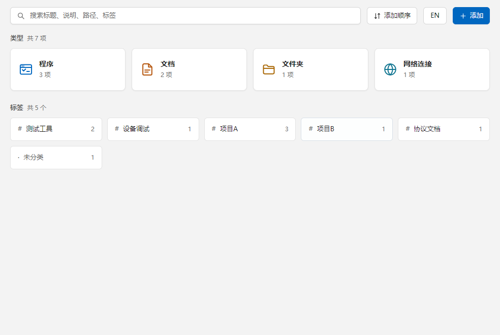
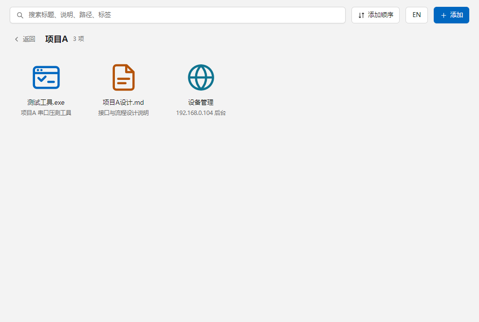
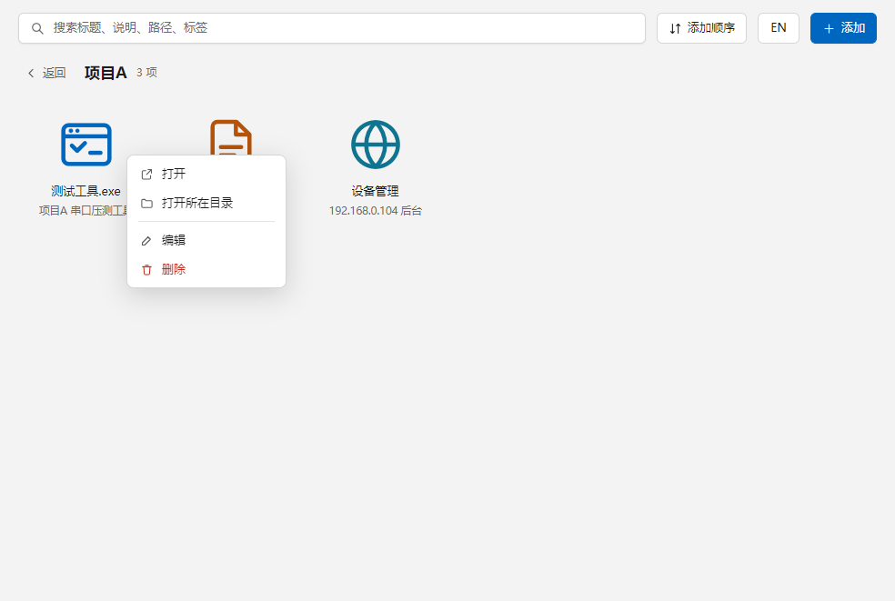
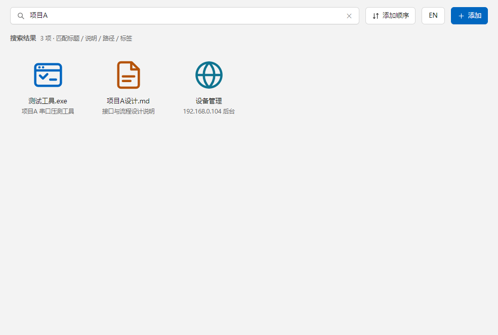
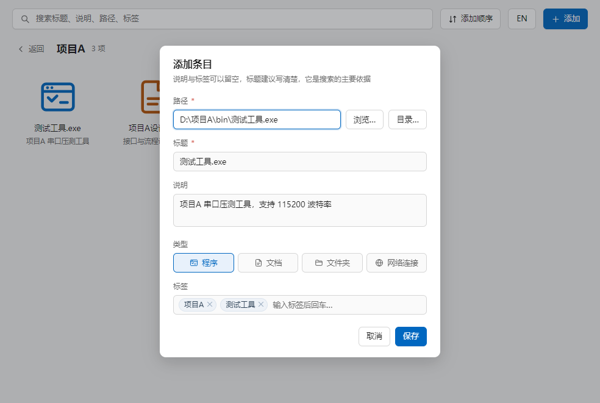

# LocalCubby

> 把散落在各个盘里的自研工具、协议文档、资料目录和常用网址收进一个窗口，双击即开。




## 为什么做这个

开发机上的东西是散的：`D:\示例程序\启动.bat` 在这、协议文档在 `D:\示例文档`、上个月写的压测工具在某个 `bin` 目录里、设备后台是个内网 IP。每次要用都得回忆路径，或者翻一遍资源管理器。

LocalCubby 把这些收成条目，用类似 Windows 桌面图标的方式摆出来，**双击就等于在资源管理器里双击**。

## 功能

- **四类条目**：程序、文档、文件夹、网络连接（网址）
- **两个分组维度**：按类型（系统固定四类）和按标签（自由多值），入口都在首页
- **双击打开**：本地路径交给系统文件关联处理，网址交给默认浏览器
- **右键菜单**：打开、打开所在目录、编辑、删除
- **搜索**：标题、说明、路径、标签名一起搜，输入即筛选，不用回车
- **排序**：添加顺序 / 名称（中文按拼音序），选择会记住
- **失效提醒**：目标被删或挪走后条目不消失，而是灰化并标注「路径不存在」，改个路径就能恢复
- **拖拽录入**：文件或文件夹拖进窗口，路径、标题、类型自动填好，只需补说明和标签
- **便携**：数据就在 exe 同级的 `data\library.json`，整个目录拷走即迁移；写入采用原子替换，断电不会写坏清单
- **中英文界面**：首次启动跟随系统语言，工具栏一键切换（当前中文显示 `EN`，当前英文显示 `中`），选择会记住；只翻译界面文案，你自己填的标题、说明、标签保持原样

## 界面

**按标签查看**——同一个工具因为打了两个标签，会同时出现在「项目A」和「测试工具」里，这是标签该有的样子：



**右键菜单**——网址类型不会出现「打开所在目录」：



**搜索**——跨全库即时过滤，打「项目A」能同时命中打了该标签的条目和标题里含该词的条目：



**添加条目**——类型按扩展名自动推断，标签回车即成 chip，下拉给出已有标签：



## 快速开始

### 直接使用

1. 获取打包产物 `release/win-unpacked/`（自行构建，见下节）
2. 双击 `LocalCubby.exe`
3. 首次运行会在 exe 同级生成 `data\library.json`

> 注意：整个目录必须可写，**不要放到 `C:\Program Files`**。放 D 盘任意位置，或用户目录下，再给 exe 建个桌面快捷方式。

### 从源码构建

```powershell
npm install        # 安装依赖
npm run dev        # 开发模式（热更新）
npm run pack       # 打包免安装目录 → release/win-unpacked
```

国内网络首次安装较慢，可以指定镜像（不改全局配置）：

```powershell
npm install --registry=https://registry.npmmirror.com
$env:ELECTRON_MIRROR='https://npmmirror.com/mirrors/electron/'
```

## 数据与备份

清单是一个纯 JSON 文件：`data\library.json`

```json
{
  "version": 1,
  "items": [
    {
      "id": "a1b2c3",
      "title": "测试工具.exe",
      "desc": "项目A 串口压测工具",
      "path": "D:\\项目A\\bin\\测试工具.exe",
      "type": "program",
      "tags": ["项目A", "测试工具"],
      "createdAt": 1763270400000
    }
  ]
}
```

`type` 只有四个值：`program` / `doc` / `folder` / `link`（`link` 的 `path` 存网址）。

备份就是复制这个文件；手工编辑也完全可以，改完重启程序即可。窗口位置尺寸另存于同目录 `window-state.json`。

## 开发

```powershell
npm run dev         # 开发模式
npm run typecheck   # 主进程 + 渲染进程类型检查
npm run build       # 构建产物（out/）
npm run pack        # 打包免安装目录（release/）
npm run smoke       # 冒烟测试：启动真实 exe + CDP 断言 14 项
```

截图脚本（生成 README 配图）：`node scripts/screenshots.mjs`

### 技术栈

| 部分 | 选型 | 说明 |
|---|---|---|
| 外壳 | Electron 33 | 只有本地进程才能启动任意本地程序 |
| 界面 | React 18 + TypeScript | 网格与分组 UI |
| 构建 | electron-vite | 主进程 / preload / 渲染进程三段构建 |
| 存储 | 单 JSON + 原子写入 | 几十~几百条规模，JSON 可直接编辑与备份 |
| 打开通道 | `shell.openPath` / `shell.openExternal` | 与资源管理器双击语义一致 |

### 目录结构

```
src/
├─ main/          主进程：窗口、IPC、数据读写、打开目标
│  ├─ index.ts
│  └─ store.ts
├─ preload/       contextBridge 暴露的最小 API
├─ shared/        主进程与渲染进程共享的类型
└─ renderer/      React 界面
   └─ src/
      ├─ App.tsx        视图路由、搜索、排序、语言切换、失效检测
      ├─ i18n.tsx       中英双语文案
      ├─ components/    卡片、网格、弹窗、右键菜单、图标
      └─ styles.css
design/           静态 HTML 设计稿（8 个画面）
scripts/          冒烟测试、截图脚本
docs/screenshots/ README 配图
```

## 已知限制

- **仅 Windows**，打包目标为免安装目录（不做安装包，避免写注册表与 AppData）
- **不提取程序图标**，四类条目使用统一的矢量图标（这是刻意的取舍，避免引入图标提取依赖）
- **无托盘、全局热键、开机自启**，关闭窗口即退出（列在 V2 候选，视使用频率决定）
- **不做**拼音首字母搜索、多标签交集筛选、批量删除、深色模式、导入导出按钮
- 失效检测只判断路径是否存在，不校验目标文件是否还能正常运行

## 仓库内文档

| 文件 | 内容 |
|---|---|
| [`design/index.html`](design/index.html) | 静态设计稿，浏览器直接打开可看 8 个画面 |
| [`CODE-INDEX.md`](CODE-INDEX.md) | 代码索引（文件、行数、职责） |

需求文档、开发指引、任务清单与开发日志属于内部工作文档，仅在本地维护，不随仓库发布。
